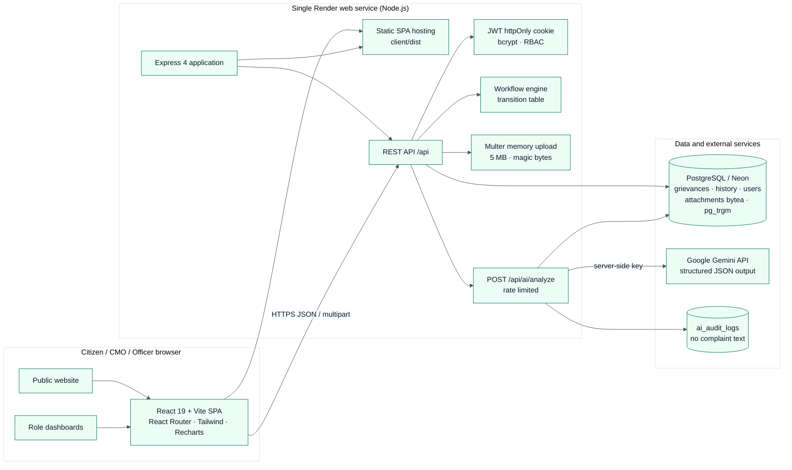

# 02 – System Architecture

> Recruitment prototype – fictional data only. Not affiliated with or endorsed by the
> Government of Kerala or the Chief Minister’s Office.

## 1. High-level architecture



Mermaid source is also kept in [`diagrams/system-architecture.mmd`](./diagrams/system-architecture.mmd)
and exported as `system-architecture.svg` / `.png`.

## 2. Deployment topology

- **One Render web service** runs Express.
- Express serves the built React application from `client/dist` for non-API GET routes and
  mounts the API under `/api`. This gives the SPA and API the same origin, so the httpOnly
  cookie works without cross-site configuration.
- **Neon PostgreSQL** is used through `DATABASE_URL` (SSL is enabled automatically for
  `neon.tech` or `sslmode=require`).
- **Gemini** is called only from the server. The API key is never sent to the browser.
- `/api/health` checks the database and is configured as the Render health check.

```
Internet ──HTTPS──▶ Render (Express + static SPA) ──TLS──▶ Neon PostgreSQL
                                  │
                                  └──HTTPS──▶ generativelanguage.googleapis.com
```

## 3. Repository layout

```
cm_portal/
├── client/                     React + Vite frontend
│   ├── public/                 favicon and static assets
│   └── src/
│       ├── components/         layout, UI primitives, charts, timeline, tables
│       ├── context/            AuthContext, ToastContext
│       ├── hooks/              useTitle
│       ├── lib/                api wrapper, constants, formatting
│       └── pages/              public, citizen, CMO, officer, shared detail
├── server/
│   ├── src/
│   │   ├── controllers/        HTTP request/response handling
│   │   ├── db/                 pool, migrations, seed, seed guard
│   │   ├── middleware/         auth, RBAC, validation, upload, errors, rate limits
│   │   ├── routes/             route definitions and role gates
│   │   ├── services/           business logic, workflow, AI, stats, duplicates
│   │   ├── utils/              AppError, async handler, SLA SQL
│   │   ├── validators/         Zod request schemas
│   │   ├── app.js              Express application factory
│   │   └── server.js           process entry point
│   └── tests/                  Jest + Supertest suites and DB setup
├── DOCUMENTATION/              this documentation set and diagrams
├── render.yaml                 Render blueprint
└── README.md
```

## 4. Backend layering

| Layer | Responsibility | Examples |
| --- | --- | --- |
| Routes | URL, HTTP verb, authentication/authorisation, validation wiring | `grievance.routes.js` |
| Controllers | Translate validated input to service calls and shape HTTP responses | `grievance.controller.js` |
| Services | Business rules, SQL, transactions, workflow, AI, stats | `grievance.service.js`, `ai.service.js` |
| Data access | Shared `pg` pool and `withTransaction` helper | `db/pool.js` |
| Cross-cutting | JWT auth, RBAC, error format, rate limiting, upload limits | `middleware/` |

The service layer is deliberately independent of Express so it can be tested and reused.
Every query uses numbered parameters (`$1`, `$2`, …); no SQL string interpolation of user
input occurs.

### Request lifecycle

1. Helmet sets security headers; CORS checks the origin allow-list.
2. JSON/urlencoded body parsing (1 MB limit) and cookie parsing.
3. A broad API rate limiter protects all `/api` routes; auth and AI routes have stricter
   limits.
4. Route-level `authenticate` verifies the JWT, reloads the user and attaches `req.user`.
5. `authorize(...roles)` enforces the role gate.
6. Zod validates body/query/params and replaces them with parsed values.
7. The controller calls the service, which may run a transaction.
8. Responses use `{ "data": ... }`; list responses add `pagination` and `summary`.
9. Errors are converted to one JSON shape by the central error handler.

## 5. Frontend architecture

- **Vite** builds the SPA. **React Router 7** provides public and protected routes.
- `AuthContext` loads `GET /api/auth/me` on boot, exposes `login`, `register`, `logout`, and
  listens for a global `auth:unauthorized` event emitted by the API wrapper on 401.
- `ProtectedRoute` blocks unauthenticated users and redirects a signed-in user to the
  dashboard for their role if they hit another role’s route.
- `ToastContext` provides success/error/info notifications.
- `AppLayout` is the dashboard shell (responsive sidebar/navbar, role badge, disclaimer);
  `SiteLayout` is the public shell (navbar and footer).
- `GrievanceTable` renders a desktop table and mobile cards. `GrievanceDetailPage` is shared
  by all roles and reveals actions based on `available_actions` and role.
- `CmoCharts` uses Recharts and real `/api/stats/cmo` aggregates.
- The API wrapper sends `credentials: 'include'`, normalises errors into `ApiError`, and
  builds authorised attachment URLs.
- Loading, empty and error states are present on data screens; forms show inline field
  errors and a visible "Fallback (not AI)" badge when the assistant degrades.

## 6. Security architecture

| Control | Implementation |
| --- | --- |
| Password storage | bcrypt (`bcryptjs`) with cost 10; max 72 characters |
| Session | Signed JWT (HS256) in an httpOnly, SameSite=Lax cookie; `Secure` in production; 7-day expiry; Bearer header also accepted for API clients |
| RBAC | `authorize()` route gates plus service-level scope checks (citizen owns case, officer department matches) |
| Input validation | Zod schemas for every mutating endpoint and list query |
| SQL injection | Parameterised queries only |
| XSS | React escapes output; no `dangerouslySetInnerHTML`; Helmet CSP |
| Clickjacking | `frameAncestors: 'none'` |
| Upload abuse | 5 MB limit, one file, MIME allow-list, magic-byte verification, authorised download only |
| Brute force | Auth rate limit (25 / 15 min / IP); global API limit 600 / 15 min |
| AI abuse | AI rate limit (15 / 10 min / IP/user session), citizen-only, 5,000-character input cap |
| Secret exposure | `GEMINI_API_KEY` server-only; `.env` gitignored; client has no key |
| Error leakage | Production hides stack traces and raw DB messages |
| PII in AI logs | Audit log stores only user id, source, model, latency, input length, language and error code |
| Prompt injection | System prompt marks complaint text as untrusted data; output is Zod-validated against fixed category/department enums |

Detailed ownership checks:

- Citizens can read only their own grievances and complaint attachments.
- Officers can list/read only grievances whose `department_id` matches theirs and whose status
  is `In Progress`, `Resolved` or `Reopened`.
- The CMO can read all grievances and attachments.
- Attachment download checks ownership/department in `getAttachmentForUser`.

## 7. Workflow enforcement

`server/src/services/workflow.service.js` contains the transition table:

```js
Submitted     → Under Review   (CMO_ADMIN)
Reopened      → Under Review   (CMO_ADMIN)
In Progress   → Resolved       (CMO_ADMIN)
In Progress   → In Progress    (DEPT_OFFICER, investigation note)
Resolved      → Reopened       (CITIZEN)
```

`canTransition(from, to, role)` is checked inside a row-locked transaction. Anything else is
rejected with `409 Conflict` and a stable error code. Assignment is separately allowed only
from `Under Review` or `Reopened` and atomically sets the department, creates the assignment
row and moves the case to `In Progress`.

Multi-row changes (assignment, report review, feedback, reopen, escalation, creation) run in
`withTransaction`; the grievance row is selected `FOR UPDATE` to prevent concurrent
transitions from racing.

## 8. Database access and transactions

- A single shared `pg.Pool` (10 connections; 5 in tests).
- `withTransaction(fn)` acquires a client, `BEGIN`s, commits or rolls back, and always
  releases the client.
- Reference IDs use `nextval('grievance_ref_seq')` inside the creation transaction; the
  sequence is collision-safe under concurrency.
- SLA/overdue is computed in SQL using `created_at + (sla days) * interval` so it is always
  current; no stale boolean is stored.
- Duplicate similarity uses `similarity(description, $1)` from `pg_trgm`, restricted to the
  same district and category.

## 9. AI architecture

The AI endpoint is a bounded, advisory side service:

```
Citizen description
   │
   ▼
Zod input validation (30–5000 chars)
   │
   ▼
Load fixed categories + departments from DB
   │
   ▼
Gemini call with system prompt + JSON schema + timeout
   │           invalid output ──▶ retry once
   │ any error / no key
   ▼
Rule-based keyword fallback (source = fallback-keyword)
   │
   ▼
Normalise to catalogue rows → duplicate lookup → audit log
   │
   ▼
Response: category, department, priority, reason, summary, language, confidence, source, duplicates
```

The citizen can accept or edit the suggestion before submission. Official fields are written
only from the form; `ai_*` columns preserve the advice and `ai_accepted` records the choice.
AI never changes status or assigns a department.

## 10. Error model

Every API error has the same shape:

```json
{
  "error": {
    "code": "CONFLICT",
    "message": "Cannot move a grievance from \"Submitted\" to \"Resolved\" as cmo admin.",
    "details": { "from": "Submitted", "to": "Resolved", "role": "CMO_ADMIN" }
  }
}
```

- `400` malformed request/file content
- `401` missing/expired session
- `403` wrong role or ownership
- `404` unknown resource/route
- `409` illegal workflow state or duplicate conflict
- `413` upload too large
- `422` Zod validation failure with `details[]`
- `429` rate limited
- `500` unexpected error (stack hidden in production)

## 11. Observability and operations

- Request logs: method, URL, status and duration (disabled in tests).
- `/api/health` returns `{status, db, uptime, env}`; `503` when the DB is unreachable.
- AI calls are recorded in `ai_audit_logs` with success, source, latency and error code.
- Render health checks use `/api/health`.
- Migrations are idempotent and run at production start. A guard seeds the database only if
  it is empty, so redeploys do not truncate data.

## 12. Scalability and trade-offs

The prototype is a single stateless web process. Session state is in the JWT, so horizontal
scaling is possible by adding Render instances. The main scaling limits are:

- Attachments in PostgreSQL `bytea` increase database size and I/O; production should use
  object storage with signed URLs.
- Duplicate detection via `pg_trgm` scans a bounded recent window; a larger dataset would
  benefit from a GIN index (present) plus stricter recency limits or embeddings.
- AI calls are synchronous; a queue would protect latency under load.
- Charts aggregate on request; materialised views or caching would help at scale.

These are documented trade-offs, not defects for a recruitment prototype.

## 13. Architecture decisions checklist

- [x] API and SPA same origin in production.
- [x] Server-side workflow authority; client cannot force a status.
- [x] AI advisory and labelled; no key in the client.
- [x] Personal data hidden on public tracking.
- [x] Every status change audited.
- [x] Parameterised SQL and transactions.
- [x] Tests, seed, migrations, health check and Render blueprint.
