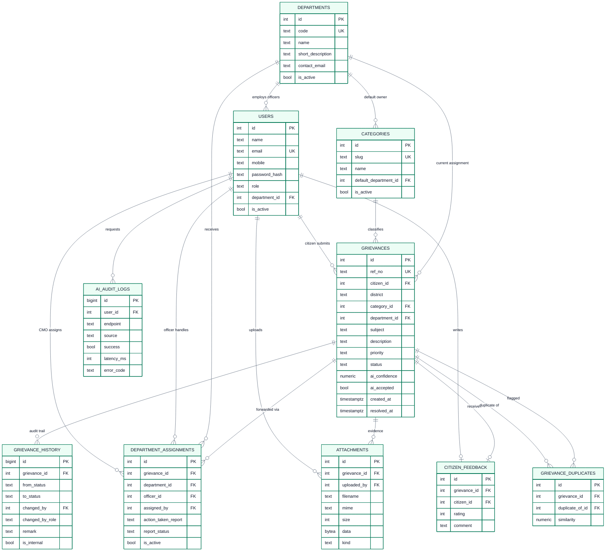

# 03 – Database Design

> Recruitment prototype – fictional data only. Not affiliated with or endorsed by the
> Government of Kerala or the Chief Minister’s Office.

The application uses **PostgreSQL** through the `pg` driver. The schema is created by
`server/src/db/migrations/001_init.sql`; the fictional demo data is loaded by
`server/src/db/seed.js`. Both are idempotent enough to rerun during development (the seed
truncates demo tables first, while production uses a seed guard that only seeds an empty DB).

## 1. Entity–relationship diagram



Mermaid source: [`diagrams/database-er.mmd`](./diagrams/database-er.mmd). Exports:
`database-er.svg` and `database-er.png`.

## 2. Tables

### 2.1 `departments`

| Column | Type | Notes |
| --- | --- | --- |
| `id` | `SERIAL PK` | |
| `code` | `TEXT UNIQUE NOT NULL` | Short code used by AI output and UI (PWD, HEALTH, …) |
| `name` | `TEXT NOT NULL` | Full fictional department name |
| `short_description` | `TEXT` | Shown on the public Departments page |
| `contact_email` | `TEXT` | Fictional contact address |
| `is_active` | `BOOLEAN` | Soft-disable without deleting history |
| `created_at` | `TIMESTAMPTZ` | |

### 2.2 `categories`

| Column | Type | Notes |
| --- | --- | --- |
| `id` | `SERIAL PK` | |
| `slug` | `TEXT UNIQUE` | Stable keyword used by the fallback classifier |
| `name` | `TEXT` | Display name |
| `description` | `TEXT` | Short description |
| `default_department_id` | `INTEGER FK → departments` | Suggested department; `ON DELETE SET NULL` |
| `is_active` | `BOOLEAN` | |
| `created_at` | `TIMESTAMPTZ` | |

### 2.3 `users`

| Column | Type | Notes |
| --- | --- | --- |
| `id` | `SERIAL PK` | |
| `name` | `TEXT NOT NULL` | |
| `email` | `TEXT` | Optional for citizens (migration `002_optional_email.sql`); case-insensitive unique index |
| `mobile` | `TEXT` | Indian mobile format; unique index on cleaned digits; required for registration |
| `password_hash` | `TEXT NOT NULL` | bcrypt cost 10; never returned by the API |
| `role` | `TEXT` | `CITIZEN`, `CMO_ADMIN`, `DEPT_OFFICER` |
| `department_id` | `INTEGER FK → departments` | Required for officers, null for citizens/CMO |
| `is_active` | `BOOLEAN` | Deactivated accounts cannot sign in |
| `created_at`, `updated_at` | `TIMESTAMPTZ` | `updated_at` trigger |

Constraints: `users_role_department_check` enforces `DEPT_OFFICER` has a department and
`CITIZEN`/`CMO_ADMIN` do not; `users_contact_identifier_check` guarantees either `email` or `mobile` is provided.

### 2.4 `grievances`

| Column | Type | Notes |
| --- | --- | --- |
| `id` | `SERIAL PK` | Internal numeric ID used in URLs/APIs |
| `ref_no` | `TEXT UNIQUE NOT NULL` | `CMK-YYYY-NNNNNN` from `grievance_ref_seq` |
| `citizen_id` | `INTEGER FK → users` | Owner; `ON DELETE RESTRICT` |
| `district` | `TEXT` | One of 14 Kerala districts (validated in API) |
| `category_id` | `INTEGER FK → categories` | Official category |
| `department_id` | `INTEGER FK → departments` | Current owner after CMO assignment; nullable earlier |
| `subject` | `TEXT` | 5–150 chars |
| `description` | `TEXT` | 30–5,000 chars |
| `priority` | `TEXT` | `Low`/`Medium`/`High`; CHECK |
| `status` | `TEXT` | Five workflow states; CHECK |
| `ai_category`, `ai_department`, `ai_priority` | `TEXT` | Advisory copy of AI advice; never overwrites official fields |
| `ai_priority_reason` | `TEXT` | AI explanation |
| `ai_summary` | `TEXT` | Neutral ≤60-word summary for the CMO |
| `ai_language` | `TEXT` | `en`, `ml`, `ml-en` |
| `ai_source` | `TEXT` | `gemini` or `fallback-keyword` |
| `ai_confidence` | `NUMERIC(4,3)` | 0.000–1.000 |
| `ai_accepted` | `BOOLEAN` | Citizen accepted the advice on the form |
| `ai_analyzed_at` | `TIMESTAMPTZ` | When AI advice was attached |
| `escalated_at`, `escalation_count` | `TIMESTAMPTZ`, `INTEGER` | CMO escalation bookkeeping |
| `resolved_at` | `TIMESTAMPTZ` | Set on resolve, cleared on reopen |
| `created_at`, `updated_at` | `TIMESTAMPTZ` | `updated_at` trigger |

The official `category_id`, `department_id` and `priority` are written only by the citizen's
final form choice or by a CMO override/assignment. AI columns are informational.

### 2.5 `grievance_history`

One row per event. This is the audit trail and the source of the citizen/public timeline.

| Column | Type | Notes |
| --- | --- | --- |
| `id` | `BIGSERIAL PK` | |
| `grievance_id` | `INTEGER FK` | `ON DELETE CASCADE` |
| `from_status` | `TEXT NULL` | Null for the initial submission |
| `to_status` | `TEXT NOT NULL` | |
| `changed_by` | `INTEGER FK → users` | Null if user deleted |
| `changed_by_role` | `TEXT NOT NULL` | Role at the time of the action |
| `remark` | `TEXT` | Human-readable explanation |
| `is_internal` | `BOOLEAN` | Internal rows are hidden from citizens/public tracking |
| `created_at` | `TIMESTAMPTZ` | |

Index: `(grievance_id, created_at ASC)`.

### 2.6 `department_assignments`

| Column | Type | Notes |
| --- | --- | --- |
| `id` | `SERIAL PK` | |
| `grievance_id` | `INTEGER FK` | `ON DELETE CASCADE` |
| `department_id` | `INTEGER FK` | |
| `officer_id` | `INTEGER FK → users` | Must belong to the department (service check) |
| `assigned_by` | `INTEGER FK → users` | CMO user |
| `assigned_at` | `TIMESTAMPTZ` | |
| `action_taken_report` | `TEXT` | Officer's report |
| `report_submitted_at` | `TIMESTAMPTZ` | |
| `report_status` | `TEXT` | `PENDING`, `SUBMITTED`, `ACCEPTED`, `SENT_BACK` |
| `report_reviewed_by` | `INTEGER FK → users` | CMO |
| `report_reviewed_at` | `TIMESTAMPTZ` | |
| `review_remark` | `TEXT` | CMO's review comment |
| `is_active` | `BOOLEAN` | One active assignment per grievance via partial unique index |

Indexes: grievance (desc by date), department, officer, unique active assignment.

### 2.7 `attachments`

| Column | Type | Notes |
| --- | --- | --- |
| `id` | `SERIAL PK` | |
| `grievance_id` | `INTEGER FK` | `ON DELETE CASCADE` |
| `uploaded_by` | `INTEGER FK → users` | |
| `filename` | `TEXT` | Sanitised original filename |
| `mime` | `TEXT` | `image/jpeg`, `image/png`, `application/pdf` |
| `size` | `INTEGER` | Bytes, max 5 MB enforced by Multer |
| `data` | `BYTEA` | File bytes stored in the database |
| `kind` | `TEXT` | `complaint` or `action_report` |
| `created_at` | `TIMESTAMPTZ` | |

### 2.8 `citizen_feedback`

| Column | Type | Notes |
| --- | --- | --- |
| `id` | `SERIAL PK` | |
| `grievance_id` | `INTEGER FK UNIQUE` | One feedback row per grievance; upsert on resubmit |
| `citizen_id` | `INTEGER FK → users` | |
| `rating` | `INTEGER` | CHECK 1–5 |
| `comment` | `TEXT` | Optional |
| `created_at` | `TIMESTAMPTZ` | |

### 2.9 `grievance_duplicates`

| Column | Type | Notes |
| --- | --- | --- |
| `id` | `SERIAL PK` | |
| `grievance_id` | `INTEGER FK` | New case |
| `duplicate_of_id` | `INTEGER FK` | Earlier case |
| `similarity` | `NUMERIC(4,3)` | `similarity()` score 0–1 |
| `created_at` | `TIMESTAMPTZ` | |
| — | UNIQUE `(grievance_id, duplicate_of_id)` | Prevents duplicate flags |
| — | CHECK `grievance_id <> duplicate_of_id` | |

Flags are advisory. Nothing is merged, rejected or auto-closed.

### 2.10 `contact_enquiries`

Standalone table for the public Contact Us form: `id`, `name`, `email`, `subject`, `message`,
`is_read` (default false), `created_at`. No user account required.

### 2.11 `ai_audit_logs`

| Column | Type | Notes |
| --- | --- | --- |
| `id` | `BIGSERIAL PK` | |
| `user_id` | `INTEGER FK → users` | Nullable if user deleted |
| `endpoint` | `TEXT` | `/api/ai/analyze` |
| `source` | `TEXT` | `gemini` or `fallback-keyword` |
| `model` | `TEXT` | Gemini model name when applicable |
| `success` | `BOOLEAN` | True only for a valid Gemini response |
| `latency_ms` | `INTEGER` | |
| `input_chars` | `INTEGER` | Length only – **no complaint text** |
| `language` | `TEXT` | Detected language code |
| `error_code` | `TEXT` | `no_api_key`, `timeout`, `quota_or_rate_limit`, `invalid_model_output`, `gemini_error`, … |
| `created_at` | `TIMESTAMPTZ` | |

## 3. Reference ID generation

```sql
CREATE SEQUENCE grievance_ref_seq START WITH 1 INCREMENT BY 1;

CREATE FUNCTION generate_grievance_ref(at TIMESTAMPTZ DEFAULT now())
RETURNS TEXT AS $$
DECLARE seq BIGINT;
BEGIN
  seq := nextval('grievance_ref_seq');
  RETURN 'CMK-' || to_char(at, 'YYYY') || '-' || lpad(seq::text, 6, '0');
END;
$$ LANGUAGE plpgsql;
```

The sequence gives uniqueness under concurrent submissions. The year is cosmetic; the number
continues across years so IDs never repeat.

## 4. Overdue / SLA calculation

Overdue is computed in SQL, never stored, so it stays correct as time passes:

```sql
(g.status <> 'Resolved'
 AND g.created_at + (CASE g.priority
       WHEN 'High' THEN 3 WHEN 'Medium' THEN 7 ELSE 15
     END || ' days')::interval < now())
```

The literal days come from the configurable SLA settings (`SLA_HIGH_DAYS`, etc.). The same
expression backs the list filter, stat cards, overdue badge and escalation eligibility.

## 5. Indexes

| Index | Purpose |
| --- | --- |
| `users_email_ci_key` (`lower(email)`) | Case-insensitive login lookup / duplicate prevention |
| `users_department_idx` | Officer lookup by department |
| `grievances_citizen_idx` | Citizen dashboard |
| `grievances_department_idx` | Officer queue |
| `grievances_status_idx`, `grievances_priority_idx` | Filters and stats |
| `grievances_district_idx`, `grievances_category_idx` | Filters and chart aggregates |
| `grievances_created_idx` | Newest-first pagination |
| `grievances_description_trgm_idx` (GIN) | `pg_trgm` duplicate similarity |
| `grievances_subject_trgm_idx` (GIN) | Subject search/duplicate support |
| `grievance_history_grievance_idx` | Timeline reads |
| `assignments_grievance_idx`, `assignments_department_idx`, `assignments_officer_idx` | Active assignment and officer queue |
| `assignments_one_active_idx` (partial unique) | At most one active department assignment |
| `attachments_grievance_idx` | Detail attachment list |
| `grievance_duplicates_grievance_idx` | Duplicate panel |
| `ai_audit_created_idx` | Audit review |

## 6. Transactions and concurrency

- Creation: sequence + grievance insert + attachment + initial history + duplicate flags in
  one transaction.
- Assignment: `SELECT … FOR UPDATE` on the grievance, deactivate the old assignment, create
  the new one, update department/status, add history.
- Status changes, remarks, escalation, report submission/review, feedback and reopen all
  lock the grievance row and commit atomically.
- Illegal transitions are rejected before any write, so the transaction rolls back cleanly.

## 7. Seed data

`npm run db:seed` truncates the demo tables and inserts:

- 10 fictional departments (PWD, Health, Education, KSEB, Water Authority, Local Self
  Government, Revenue, Transport, Police, Social Justice).
- 12 categories mapped to default departments.
- 1 CMO administrator (`cmo@demo.test`) and 10 department officers
  (`officer.pwd@demo.test`, `officer.health@demo.test`, …).
- 3 citizens (`citizen@demo.test`, `ravi.menon@demo.test`, `fatima.noor@demo.test`).
- 40 grievances spread over 14 districts, all five statuses, all priorities and dates relative
  to the seed run (some deliberately overdue), with realistic history, assignments, reports,
  feedback and a few duplicate flags/attachments.
- Demo password: `Demo@12345` (test accounts only).

All names, emails, mobile numbers, descriptions and remarks are fictional.

## 8. Data protection and retention notes

- Public tracking returns only reference, subject, district, category, department, priority,
  status, dates and public timeline. It never returns name, email, mobile or internal notes.
- Citizens see only public history rows and complaint attachments. Action-report evidence is
  visible to staff only.
- AI audit logs intentionally omit complaint text and personal identifiers beyond `user_id`.
- Attachments are served with `Content-Disposition`, `X-Content-Type-Options: nosniff` and an
  authorisation check; no public static directory exposes them.
- A production system would need encryption at rest/in transit beyond Neon defaults, data
  retention policies, audit access controls, malware scanning and a DPDP Act assessment.

## 9. Migration and reset commands

```bash
npm run db:migrate          # apply pending SQL files
npm run db:seed             # truncate + insert fictional demo data
npm run db:reset            # migrate then seed
```

For tests, `server/tests/globalSetup.js` drops and recreates the `public` schema in
`DATABASE_URL_TEST`, applies migrations and seeds before the suite runs.
